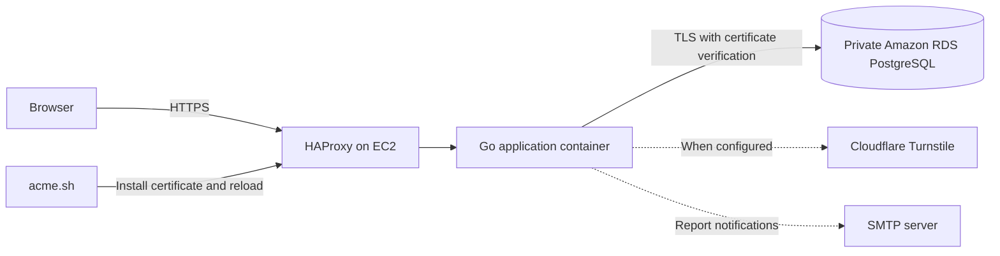

# ezvacss.xyz

[](https://github.com/ezvacss/ezvacss.xyz/actions/workflows/test.yml?query=branch%3Astaging)
[](https://github.com/ezvacss/ezvacss.xyz/actions/workflows/lint.yml?query=branch%3Astaging)
[](https://github.com/ezvacss/ezvacss.xyz/actions/workflows/security.yml?query=branch%3Astaging)

A Go and PostgreSQL URL shortener, with a vanilla JavaScript frontend and an AWS deployment managed through OpenTofu, Ansible, and GitHub Actions.

This is a personal application and a hands-on DevOps learning project. The repository includes the application, container definitions, infrastructure configuration, and staging deployment automation.

[Staging application](https://staging.ezvacss.xyz) | [Container images](https://github.com/ezvacss/ezvacss.xyz/pkgs/container/ezvacss.xyz) | [GitHub Actions](https://github.com/ezvacss/ezvacss.xyz/actions)

## Features

- Shorten URLs into seven-character Base62 codes and redirect visitors to their destinations.
- Preview a shortened URL's destination without following the redirect.
- Register and sign in to associate links with an account.
- View account-specific link statistics and recent activity, including click counts and location data where available.
- Submit abuse reports, with optional SMTP notifications to the administrator.
- Validate Cloudflare Turnstile tokens when the integration is configured.
- Check application and database connectivity through `/healthz`.

## Stack

| Area | Technology |
| --- | --- |
| Backend | Go, standard-library `net/http`, pgx connection pool |
| Frontend | HTML, CSS, vanilla JavaScript |
| Database | PostgreSQL; Amazon RDS for staging |
| Packaging | Multi-stage Docker build with a non-root runtime user |
| Traffic and TLS | HAProxy, acme.sh, Let's Encrypt |
| Infrastructure | AWS EC2, VPC security groups, private RDS subnets, S3 state storage, OpenTofu |
| Server configuration | Ansible, Docker CE, Docker Compose |
| Secrets | AWS Secrets Manager and protected environment files on the server |
| CI/CD | GitHub Actions, GHCR, build provenance attestations |
| Quality checks | Unit tests, golangci-lint, govulncheck, Trivy |
| Dependency updates | Renovate, configured on the repository's default branch |

## Architecture



The Go process serves both the API and files in `public/`. The RDS-backed staging stack runs the application, HAProxy, and ACME services with Docker Compose. It does not run a local PostgreSQL container.

Kubernetes, Flux, and a centralized observability stack are not part of the current deployment.

## Local Development

The commands below use Bash, including WSL on Windows. Run them from the repository root unless stated otherwise.

### Requirements

- Git.
- Docker Engine or Docker Desktop with Docker Compose v2 or newer.
- Go matching `go.mod` if running tests or the application outside Docker.

### Start the Application and Database

```bash
git clone --branch staging https://github.com/ezvacss/ezvacss.xyz.git
cd ezvacss.xyz
```

Create a local, untracked `.env` file in the repository root:

```dotenv
APP_IMAGE=ezvacss.xyz:local
SMTP_HOST=
SMTP_PORT=
SMTP_USER=
SMTP_PASSWORD=
ADMIN_EMAIL=
SENDER_EMAIL=
TURNSTILE_SECRET_KEY=
```

Start only the local application and its PostgreSQL dependency:

```bash
docker compose --env-file .env \
  -f infra/docker/docker-compose.yml \
  up -d --build --wait app
```

Open [http://localhost:8080](http://localhost:8080). Verify the database-backed health check:

```bash
curl -fsS http://localhost:8080/healthz
```

Expected response:

```json
{"status":"ok"}
```

This starts neither HAProxy nor ACME. HTTPS, secure-cookie authentication, and hostname-specific Turnstile widgets require additional configuration for a full browser authentication test. The backend bypasses Turnstile verification when its secret is empty; leave it empty only for isolated local development.

The local Compose file uses development-only database credentials and publishes ports 8080 and 5432 on the host. Use it only on a trusted development machine, not as a public deployment configuration.

### Rebuild After Go Changes

```bash
docker compose --env-file .env \
  -f infra/docker/docker-compose.yml \
  up -d --build --wait app
```

Go changes require a rebuild in this container workflow. Static files are bind-mounted from `public/`; the Go binary is not hot-reloaded.

To stop the local stack:

```bash
docker compose --env-file .env \
  -f infra/docker/docker-compose.yml down
```

The PostgreSQL data is stored in a host bind mount and remains after `down`.

## Configuration

| Variable | Purpose |
| --- | --- |
| `DATABASE_URL` | PostgreSQL connection string. Local Compose supplies it; RDS staging reads it from `.env.rds`. |
| `PORT` | HTTP listener port; defaults to `8080`. |
| `APP_IMAGE` | Compose image reference. Staging deployment requires an exact `@sha256:` digest. |
| `TURNSTILE_SECRET_KEY` | Server-side Cloudflare Turnstile verification secret. |
| `SMTP_HOST`, `SMTP_PORT` | SMTP server address and port. |
| `SMTP_USER`, `SMTP_PASSWORD` | SMTP authentication credentials. |
| `ADMIN_EMAIL` | Recipient of abuse-report notifications. |
| `SENDER_EMAIL` | Sender address for notifications. |

`APP_IMAGE` is consumed by deployment tooling, not by the Go application. Frontend Turnstile site keys are configured in the static assets and must match the intended environment.

The application creates or updates its embedded database schema during startup. The application database role therefore currently needs more than ordinary read/write permissions.

## HTTP Endpoints

| Method | Endpoint | Purpose |
| --- | --- | --- |
| `POST` | `/shorten` | Create a short URL from a JSON `url` field. |
| `GET` | `/{code}` | Redirect to the stored destination with HTTP 302. |
| `GET` | `/api/unshorten?code={code}` | Return the destination and creation time. |
| `POST` | `/api/register` | Create an account. |
| `POST` | `/api/login` | Sign in and set a session cookie. |
| `POST` | `/api/logout` | Clear the current session. |
| `GET` | `/api/user` | Return current authentication information. |
| `GET` | `/api/stats` | Return statistics for the signed-in user's links. |
| `POST` | `/api/report` | Submit an abuse report. |
| `GET` | `/healthz` | Return 200 when PostgreSQL is reachable, otherwise 503. |

For example, against the local instance with Turnstile verification disabled:

```bash
curl -fsS http://localhost:8080/shorten \
  -H 'Content-Type: application/json' \
  -d '{"url":"https://example.com"}'
```

Guest shortening, registration, login, and reporting require valid Turnstile tokens when verification is enabled. Replace any illustrative short code with one created in the same environment you are querying.

## Checks

```bash
go test ./...
go vet ./...
```

To run the Go vulnerability scanner after installing it:

```bash
go install golang.org/x/vuln/cmd/govulncheck@latest
govulncheck ./...
```

GitHub Actions also runs golangci-lint, builds the container, and scans it with Trivy. The container scan fails for detected HIGH or CRITICAL vulnerabilities with available fixes. See [the workflow files](.github/workflows) for the current tool versions and settings.

## CI/CD

```text
Feature branch -> pull request -> staging
                                  |
                          Tests, lint, security
                                  |
                       Build and publish to GHCR
                                  |
                    Generate provenance attestation
                                  |
                    Ansible deployment over SSH
                                  |
                        Public HTTPS smoke test
```

Pushes to `staging` and `production` run the publish workflow. Deployment is currently enabled only for `staging`; publishing from `production` does not automatically deploy a production server.

The publish job passes its output image digest to Ansible. Deployment uses `ghcr.io/ezvacss/ezvacss.xyz@sha256:<digest>` rather than resolving the movable `staging` tag later. Ansible validates configuration, waits for services, checks the mounted HAProxy configuration, and verifies the public endpoint with TLS certificate validation enabled.

Configure these secrets in GitHub's `staging` environment:

| Secret | Purpose |
| --- | --- |
| `STAGING_HOST` | SSH destination address. |
| `STAGING_USER` | Remote deployment username. |
| `STAGING_SSH_KEY` | Deployment private key; its public half must be authorized on the server. |
| `STAGING_KNOWN_HOSTS` | Verified OpenSSH host-key entry for the destination. |

The deploy job expects the server and runtime settings to have been provisioned already. It does not retrieve application secrets from AWS on every deployment. Never disable host-key verification to work around an SSH error.

## Infrastructure and Operations

| Path | Purpose |
| --- | --- |
| `infra/tofu-new/bootstrap/` | State bucket, versioning, encryption, and public-access protection. |
| `infra/tofu-new/staging/` | EC2, security groups, private database networking, and RDS. |
| `infra/tofu/` | Legacy infrastructure configuration retained during migration cleanup. |
| `infra/ansible/bootstrap.yml` | Base server preparation and Docker CE installation. |
| `infra/ansible/prepare-staging-rds.yml` | Deployment directories, configuration files, and RDS CA bundle. |
| `infra/ansible/provision-app-env.yml` | Provision protected application and database environment files from AWS secrets. |
| `infra/ansible/deploy-staging.yml` | Deploy an exact application image digest and verify the endpoint. |
| `infra/docker/docker-compose.yml` | Local build with containerized PostgreSQL. |
| `infra/docker/docker-compose.staging.yml` | Earlier registry-image stack with containerized PostgreSQL. |
| `infra/docker/docker-compose.staging-rds.yml` | Registry-image stack using external RDS PostgreSQL. |
| `infra/haproxy/haproxy.cfg` | Reverse proxy, application health checks, Docker DNS, and ACME routing. |

These configurations contain environment-specific account guards, backend names, paths, and database settings. Review them before adapting the project to another AWS account; they are not a turnkey deployment into an arbitrary account.

The secrets provisioning playbooks read `ezvacss/staging/database-app` and `ezvacss/staging/app-config` using the controller's AWS credentials. They render `.env.rds` and `.env` on the server with mode `0600`. RDS connections verify both the certificate chain and database hostname.

On a new server, ACME must first be enrolled for the domain and its deployment hooks configured, or its existing state migrated securely. Starting its daemon alone does not issue a trusted certificate. The temporary localhost certificate is only a bootstrap fallback.